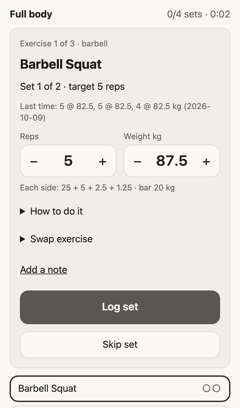
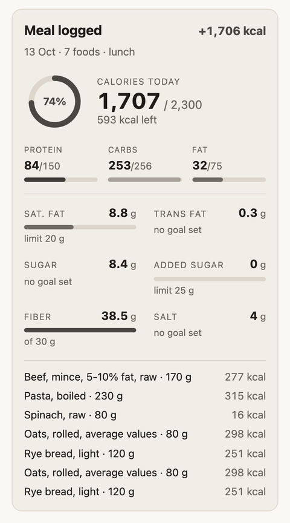
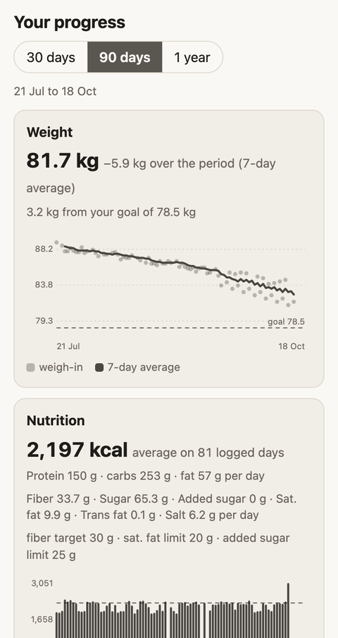
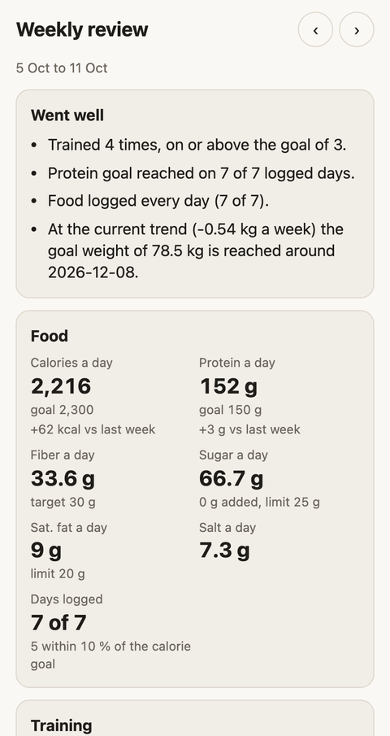
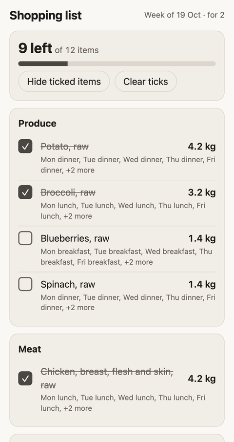
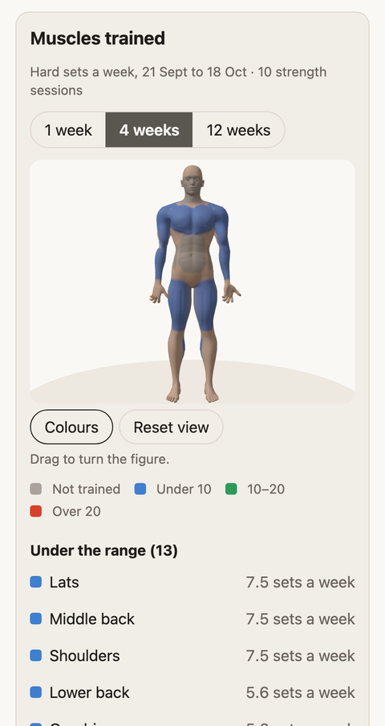

# Fitwell for Claude

Track food, training and weight by talking to Claude. A calm fitness and meal tracker that lives inside Claude, as a remote [MCP](https://modelcontextprotocol.io) server.<br>
[fitwell.fyi](https://fitwell.fyi) · invite-only · health data stored in the EU

<br clear="left">

<table>
<tr><td align="center" valign="top"><picture><source media="(prefers-color-scheme: dark)" srcset="docs/images/hero-squat-dark.png"></picture><br><sub>Workout player</sub></td><td align="center" valign="top"><picture><source media="(prefers-color-scheme: dark)" srcset="docs/images/food-dark.png"></picture><br><sub>Food summary</sub></td><td align="center" valign="top"><picture><source media="(prefers-color-scheme: dark)" srcset="docs/images/dashboard-dark.png"></picture><br><sub>Progress dashboard</sub></td></tr>
<tr><td align="center" valign="top"><picture><source media="(prefers-color-scheme: dark)" srcset="docs/images/review-dark.png"></picture><br><sub>Weekly review</sub></td><td align="center" valign="top"><picture><source media="(prefers-color-scheme: dark)" srcset="docs/images/shopping-dark.png"></picture><br><sub>Shopping list</sub></td><td align="center" valign="top"><picture><source media="(prefers-color-scheme: dark)" srcset="docs/images/muscles-dark.png"></picture><br><sub>Muscle map</sub></td></tr>
</table>

## What it does

Tell Claude what you ate, ask it to plan your week, start a workout from the chat and open a dashboard when you want to see how you are doing. Small interactive views appear right in the conversation; everything else Claude explains in words.

- **Food and macros without the typing.** Describe a meal in your own words. Claude turns amounts into grams, finds each food in a database (1,381 everyday foods from [Frida](https://doi.org/10.11583/DTU.29500682), packaged products by barcode through [Open Food Facts](https://world.openfoodfacts.org)) and saves calories, protein, carbs, fat and the rest of the label: fibre, sugars, saturated and trans fat, salt. "Same breakfast as yesterday" repeats a meal in one step.
- **A calorie goal that learns your real burn.** After a few weeks of logging food and weighing in, Fitwell compares what you ate with how your weight moved, measures your burn and suggests calories for your goal, with the date you reach it at the current trend.
- **Workouts you start from the chat.** A player with big buttons: sets and reps, a rest timer, warm-up ramps, supersets, timed sets, plates per side, swap-when-the-machine-is-busy, notes, cardio steps and a summary. Weights follow your history by a fixed progression rule.
- **How to do it, in 3D.** Exercise guides with an animated 3D body, the muscles worked, steps and machine setup, and a muscle map of the weekly hard sets per muscle.
- **A week of meals and the shopping list.** Plans checked against your goals, allergies and dislikes, recipes imported from a link, "what can I cook?" from what is in the fridge, and a tick-off grocery list.
- **A weekly review.** The week against the one before, what went well, and a few things to consider; the calorie goal is only changed when you agree.
- **Little things.** Allergen warnings, a morning brief as a scheduled task in Claude, export of everything, delete your account any time.

## How it works

```
 you ──► Claude ──► Fitwell MCP server (Cloudflare Worker) ──► D1 database (EU)
          ▲                │
          └── views ◄──────┘   MCP Apps: small pages Claude renders in the chat
```

- The server speaks MCP over HTTP with OAuth 2.1 sign-in by email code (invite-only). Every query is bound to the signed-in person.
- Views (workout player, dashboard, weekly review, shopping list, exercise guide, food summary) are single self-contained HTML pages built from `apps/mcp/ui/*`.
- Shared code, the Frida and exercise datasets and the Open Food Facts client live in `packages/core`.

## Your data

Food, weight, workouts, sleep and allergies are health data. They are kept in a database restricted to the EU, never sold or shared, and nothing leaves the Worker except lookups to Open Food Facts and sign-in emails. You can export everything or delete your account from the chat. Details: [mcp.fitwell.fyi/privacy](https://mcp.fitwell.fyi/privacy).

## Repository

An npm workspaces monorepo.

| Workspace | What it is |
|---|---|
| [`apps/mcp`](apps/mcp/README.md) (`@fitwell/mcp`) | Fitwell for Claude: a remote MCP server on Cloudflare Workers (see [its plan](apps/mcp/PLAN.md) and [roadmap](apps/mcp/ROADMAP.md)). |
| [`apps/landing`](apps/landing/README.md) | The landing page at [fitwell.fyi](https://fitwell.fyi) (a Cloudflare Worker serving static assets). |
| [`packages/core`](packages/core/README.md) (`@fitwell/core`) | Shared data model, domain logic, bundled datasets (Frida 5.5, free-exercise-db), search and the Open Food Facts client. |

The earlier Fitwell web app (a local-only PWA) was retired on 2026-10-16. Its backup files can still be imported with the `import_fitwell_backup` tool.

## Develop

Node 22+ (see `.node-version`). Install once from the repository root:

```bash
npm install
```

| Command (from the root) | What it does |
|---|---|
| `npm run dev` | MCP server in the local Workers runtime on :8787 (setup in [apps/mcp](apps/mcp/README.md#develop)) |
| `npm run check` | typecheck + lint + unit tests in every workspace |
| `npm run typecheck` · `lint` · `test` | One of those steps, in every workspace |

Run any workspace script directly with `npm run <script> -w <workspace>`.

## Credits

Food data: [Frida 5.5](https://doi.org/10.11583/DTU.29500682), DTU National Food Institute (CC BY 4.0), and [Open Food Facts](https://world.openfoodfacts.org) contributors (ODbL). Exercises: [free-exercise-db](https://github.com/yuhonas/free-exercise-db) (Unlicense).
